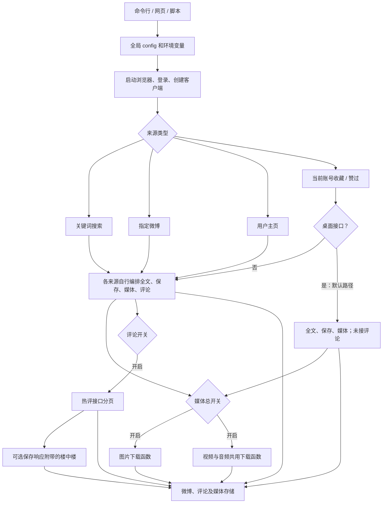
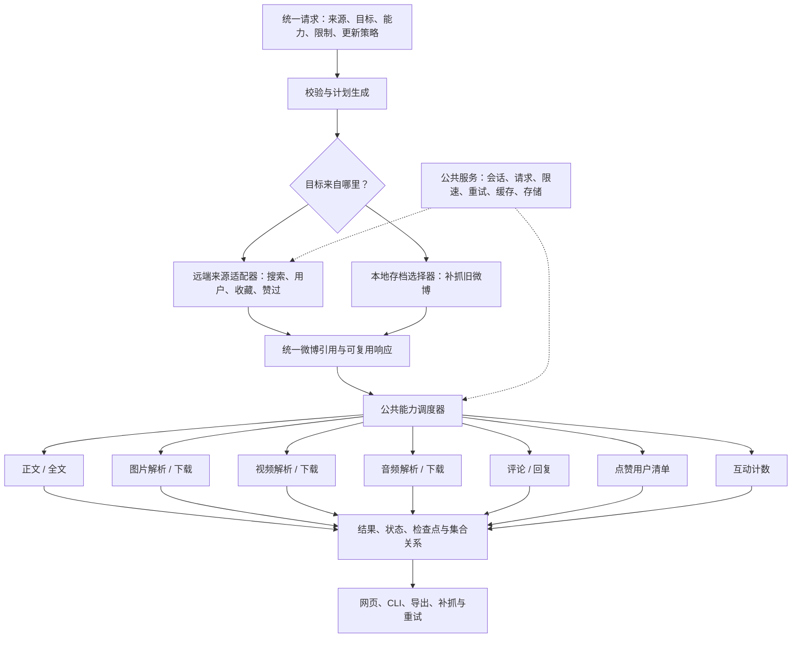
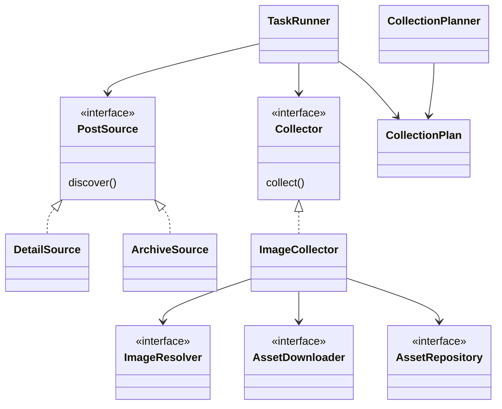

# 微博按需采集架构设计

> 版本：v0.6 · 日期：2026-10-28 · 状态：架构设计；正文、图片、视频、音频已接入 CLI 和本地任务页面；在线样本验证覆盖图片
>
> 本文整理旧实现、目标架构及实施路径。第 13 节明确当前落地范围；其余接口与模块仍为目标设计。除明确记录的真实链接样本外，代码核查与本地统计不能作为其他在线接口已验证的证据。

## 1. 目标与范围

将微博采集组织为可组合的基础能力。调用方提交“从哪里找微博、处理哪些微博、需要哪些数据、各项数量和更新要求”，系统统一生成执行计划，执行所选能力，分别保存结果和状态。

典型场景：

- 抓某用户历史微博，只保存正文。
- 抓自己的收藏，保存正文、图片和视频文件。
- 给已归档微博补抓评论，无需重新扫描用户全部历史。
- 给已有正文补抓视频，仅重试之前失败的下载。
- 抓互动计数与点赞用户清单，并明确区分两者。

### 1.1 核心原则

1. **来源与能力分离**：用户主页、搜索、收藏等负责发现微博；正文、媒体、评论等负责补充数据。
2. **按任务选择**：任务执行时使用确定的请求参数，能力模块不直接读取可变全局配置。
3. **按需请求**：未选择的能力不产生额外请求、下载和对应业务结果写入。
4. **复用已有响应**：来源接口附带正文、图片地址等是正常现象；不承诺控制服务端返回字段。允许任务内复用，不等同于主动采集所有能力。
5. **按能力管理状态**：正文存在不代表视频、评论也已完成。
6. **如实表达覆盖范围**：达到上限、接口访问受限、无内容、失败必须区分；不能将“接口本次返回结束”解释为“平台历史绝对完整”。
7. **领域模型主导**：从对象职责、契约和依赖方向设计，以组合复用基础能力；旧接口的兼容性不决定新架构。

### 1.2 本轮设计不包含

- 重构其他平台，或立即建设通用多平台框架。
- 恢复从未归档过的已删除内容、获取当前账号不可访问的内容。
- 保证他人收藏、赞过或点赞用户接口一定可访问。
- 把未验证的接口列为已支持能力。

## 2. 当前实现

### 2.1 代码地图

以下路径均相对仓库根目录。

| 位置 | 当前职责 |
| --- | --- |
| `main.py`、`cmd_arg/arg.py` | 解析命令行，修改全局配置，创建并启动爬虫 |
| `config/base_config.py`、`config/weibo_config.py` | 来源、目标、开关、数量、保存策略等默认配置 |
| `media_platform/weibo/core.py` | 登录初始化、来源分发、全文补抓、媒体与评论编排、续跑和删除推断 |
| `media_platform/weibo/client.py` | 桌面/移动接口、详情解析、分页、部分重试、资源下载 |
| `store/weibo/__init__.py` | 将接口数据转换为存储记录、存档统计、更新缓冲 |
| `store/weibo/_store_impl.py` | JSONL、数据库等存储实现，JSONL 去重和更新策略 |
| `store/weibo/weibo_store_media.py` | 图片及视频/音频文件写入 |
| `weibo_web/main.py`、`weibo_web/tasks.py` | 网页接口、启动脚本/子进程、任务查询 |
| `scripts/crawl_user.py`、`scripts/batch_crawl_tracked.py` | 单用户和跟踪用户批量采集 |
| `scripts/sync_follows_fans.py` | 当前账号关注/粉丝同步与变化记录 |
| `tools/weibo_jsonl_to_html.py` | 从存档生成 HTML，可附带图片下载 |

### 2.2 当前逻辑框图



图为流程概括，具体顺序随来源不同：例如用户主页先逐页保存微博，再处理该轮取得的评论和媒体。

### 2.3 已有来源与数据能力

| 项目 | 当前实现 | 限制与缺口 |
| --- | --- | --- |
| 来源 | 搜索、指定微博 ID、用户主页、我的收藏、我的赞过 | 各来源重复编排数据抓取；收藏/赞过使用当前登录账号 |
| 正文 | 保存清洗文字、原始 HTML、作者、时间和链接等 | 默认保存，没有独立任务选择 |
| 全文 | `get_note_full_text()` 根据 `isLongText` 追加详情请求 | 失败后保留原条目，无完整性状态；未递归补全转发原文 |
| 转发原文 | 保存原作者、正文、时间、图片链接等 `rt_*` 字段 | 不保证转发链递归完整 |
| 图片 | 读取 `pics`，优先大图，支持下载 | 下载主要处理外层图片；不同接口结构需统一适配 |
| 视频 | 读取若干 MP4 字段，支持转发原文回退和下载 | 页面链接可被写入 `video_url`；链接与直链混用，无通用播放页解析 |
| 音频 | 读取 `page_info.audio_url`，复用文件下载 | 未见通用音乐页解析，本地暂无成功样本 |
| 互动计数 | 保存点赞、评论、转发数量 | 是抓取时快照，不是用户清单 |
| 一级评论 | `hotflow` 接口分页，按配置数量抓取 | 各来源接入不一致；当前第一页被标作热评 |
| 回复 | 保存一级响应中附带的 `comments` | 没有独立回复分页，不能视为全部楼中楼 |
| 点赞用户 | 无 | 待新增并验证接口与权限 |
| 指定微博的转发列表 | 无 | 待新增，与转发数区分 |
| 用户资料 | 可保存昵称、头像、简介、关注/粉丝数等 | 与主页采集绑定较多 |
| 关注/粉丝 | 有当前账号同步脚本 | 旧关系未清除，取关/掉粉不能可靠识别；应作为用户级能力另行维护 |

当前默认配置：`ENABLE_WEIBO_FULL_TEXT=True`、`WEIBO_USE_PC_AJAX=True`、`ENABLE_GET_MEIDAS=False`、`ENABLE_GET_COMMENTS=False`、`ENABLE_GET_SUB_COMMENTS=False`、`WEIBO_SAVE_POLICY="skip"`。历史拼写 `MEIDAS` 在兼容层保留，新参数使用 `images/video/audio`。

### 2.4 当前状态管理的问题

- `WeiboCrawler` 同时管理来源、正文补全、评论、媒体、存储与恢复，修改一个能力容易影响多条路径。
- 图片、视频、音频共享总开关，无法按任务分别选择。
- 配置散落在全局配置、环境变量、命令行和脚本参数中，缺少一份可回溯的任务快照。
- JSONL 去重加载所有 `*contents*.jsonl` 的微博 ID；收藏等导出也使用已存 ID 过滤。某微博在其他集合出现后，可能影响当前集合的写入，微博实体与集合归属没有独立建模。
- `skip/refresh/full-update` 主要面向整条记录，没有“正文已完成，视频待补抓”的语义。
- 用户历史续跑用已存数量估算页码；持续空页可能被跳过或当作结束，没有独立缺口清单。
- 评论错误主要写日志，没有按微博保存可重试状态。
- 各数据库表字段与当前 JSONL 扩展字段并不完全一致，不能直接承诺所有后端承载相同新模型。

### 2.5 本地成果与证据边界

2026-10-27 对现有 `data/weibo/jsonl/*_contents_*.jsonl` 按各集合微博 ID 去重统计：

| 集合 | 微博数 |
| --- | ---: |
| `creator` | 29,646 |
| `favorite` | 7,932 |
| `liked` | 684 |
| `user_3749461410` | 613 |
| `user_5765533535` | 126 |

主归档发布时间范围约为 2010-05-21 至 2026-08-18；图片目录有 6,262 个文件，视频目录有 1 个文件。未发现评论 JSONL 文件，统计到的微博记录无非空 `audio_url`。

这些数据证明部分功能产生过实际成果，不能证明已覆盖平台全部内容或所有媒体均已下载。旧进度报告记录过时间段缺口，属于历史观察，应在新系统中保留为覆盖信息，而非据此断言当前接口情况或缺口根因。

## 3. 预期架构

### 3.1 目标逻辑框图



### 3.2 分层职责

| 层 | 职责 | 不应承担的职责 |
| --- | --- | --- |
| 入口适配 | 将网页、CLI、旧脚本转换成统一请求 | 自行组合图片、评论抓取步骤 |
| 计划生成 | 校验支持性、参数和依赖，计算执行步骤 | 将缺失能力静默当作成功 |
| 来源适配 | 发现微博，维护分页、集合归属与发现边界 | 决定是否补全文、下载视频 |
| 数据适配 | 将桌面/移动响应转为统一字段 | 用一个非空 URL 断言存在可下载视频 |
| 能力模块 | 处理一种数据，返回结果及覆盖状态 | 直接修改全局配置、管理整个用户历史 |
| 调度器 | 依赖复用、状态判断、逐条/逐页执行与持久化 | 绑定某个固定用户 |
| 公共服务 | 会话、请求、超时、限速、缓存、文件与结果保存 | 把风控响应一律解释为无数据 |

用户资料、关注/粉丝属于用户级实体能力，不塞进“每条微博执行”的循环；本轮先保持独立，通过同类任务模型逐步接入。

### 3.3 对象职责与设计模式

| 对象 | 职责与边界 |
| --- | --- |
| `CrawlRequest` | 外部任务契约；原始参数在计划阶段规范化为不可变执行选项与快照 |
| `PostSource` | 发现微博引用，不选择或执行采集能力 |
| `PostRef` | 微博身份及可复用的已知信息，不携带客户端或全局配置 |
| `CollectionPlanner` | 注册能力、校验选项、生成执行计划；未来扩展依赖复用 |
| `CollectionPlan` | 已验证的步骤、选项、更新策略与预算 |
| `Collector` | 单项数据采集策略，与来源、网页、命令行隔离 |
| `CollectionResult` | 业务结果、覆盖程度和安全错误代码 |
| `TaskRunner` | 编排步骤、隔离失败、持久化工作和执行进度 |
| `Repository` | 管理状态或资源，隐藏 SQLite、文件等实现 |

使用策略模式表达来源和采集能力，适配器模式统一平台响应，仓储模式隔离存储，以构造函数依赖注入实现组合。仅在真实替换点使用 `Protocol`；不为每个业务类创建抽象父类，不建立按“用户视频爬虫、收藏评论爬虫”排列的继承树。



图片模块只负责编排图片解析、复用、下载并汇总结果。视频和音频由同一个 `MediaCollector` 按媒体类型组合解析器、流式下载器、签名校验策略和资源仓储；大文件分块写盘并在取消时清除临时文件。三类媒体共用 `MediaAsset` 身份与文件仓储，不将播放页当作下载直链。任务计划仍是所选步骤的简单序列，不建设通用工作流引擎。

## 4. 统一任务契约

### 4.1 示例：用户微博正文、图片、视频与评论

下列字段名、接口名称是拟定契约。

```json
{
  "schema_version": 1,
  "source": {
    "type": "creator",
    "user_ids": ["1401527553"],
    "mode": "incremental"
  },
  "collect": {
    "text": {"full_text": true},
    "images": {"download": true, "include_retweeted": true},
    "video": {"download": true, "include_retweeted": true},
    "comments": {
      "order": "hot",
      "max_count": 100,
      "include_replies": false
    }
  },
  "update": {"default": "missing"},
  "limits": {"max_posts": 1000},
  "output": {"collection": "user_1401527553"}
}
```

语义：未出现在 `collect` 中的能力不执行；因此不抓音频、点赞用户清单，也不单独刷新互动计数。`max_posts` 是本任务发现/接纳的去重微博上限；每个来源目标分别保存分页状态。评论与回复限额另计。

### 4.2 示例：从旧存档补抓评论

```json
{
  "schema_version": 1,
  "source": {
    "type": "archive",
    "collection": "favorite",
    "note_ids": ["4982041758140155"]
  },
  "collect": {
    "comments": {
      "order": "hot",
      "max_count": 100,
      "include_replies": true,
      "max_replies_per_comment": 50
    }
  },
  "update": {"default": "missing"}
}
```

不重新扫描收藏列表，不因正文已存在而跳过评论。`archive` 的集合及 ID 同时指定时取交集；只传 ID 可使用独立的 `detail` 来源。第一版不支持无边界的回复数量，后续扩展必须明确分页与预算。

### 4.3 参数规则

| 类别 | 建议字段与规则 |
| --- | --- |
| 来源 | `creator/search/detail/favorite/liked/archive`，按类型校验必填目标；收藏/赞过绑定实际登录账号 |
| 发现模式 | 远端列表支持 `full/incremental/resume`；`full` 从头扫描当前可访问范围，`resume` 使用指定任务检查点；本地 `archive` 不使用远端发现模式 |
| 正文 | `text.full_text`；转发原文补全另设 `include_retweeted`，禁止隐式无限递归 |
| 媒体 | `images/video/audio` 独立选择；`download=false` 只解析并保存链接，`true` 解析后下载；转发原文按选项处理 |
| 评论 | `order/max_count/include_replies/max_replies_per_comment`；`max_count` 仅计一级评论，回复独立计数 |
| 点赞 | `metrics` 保存数量；`likers.max_count` 抓用户清单；两者互不替代 |
| 更新 | `missing/refresh/retry_failed`，支持按能力覆盖；刷新使用时间戳和明确范围，不能覆盖其他能力字段 |
| 输出 | 逻辑集合；存储和会话设置由运行服务提供，任务快照记录所用适配器版本 |

`collect` 为空、未知能力、无效数量、未实现的排序、回复分页或点赞用户能力，均在发起抓取前返回明确错误。参数支持表应包含能力及选项粒度，不能只检查能力名称。必要的会话权限检查可以在登录后执行，失败标记为受限，不伪装为空列表。

网页和 CLI 的默认值显式生成请求；新接口中省略的能力一律不启用。旧入口允许由兼容层映射旧配置，并记录最终请求快照。

## 5. 能力模块与执行计划

### 5.1 最小协议

建议定义类型化对象：

- `CrawlRequest`：经过校验的不可变任务请求。
- `PostRef`：平台、微博 ID、来源账号和集合、可复用响应引用。
- `PostSnapshot`：统一字段及其来源、获取时间、字段是否截断；不能靠空字符串表达全部状态。
- `CapabilitySpec`：能力名称、支持选项、依赖及实现版本。
- `CapabilityResult`：业务结果、状态、数量、覆盖范围、重试原因及产物引用。
- `TaskContext`：会话、客户端、任务内缓存、存储、限速器和取消信号。

每个能力提供类似 `collect(post_ref, options, context) -> CapabilityResult` 的统一入口；内部可调用已有客户端方法。来源提供异步条目流和显式检查点，不要求先把整个用户历史放入内存。

### 5.2 依赖与请求复用

| 选择的能力 | 可能需要的前置步骤 | 复用规则 |
| --- | --- | --- |
| 全文 | 详情响应；若列表已是完整正文则省略 | 同条微博同轮可与媒体解析共用详情 |
| 图片/视频/音频解析 | 标准化列表响应，必要时补详情 | 一个详情响应服务多个能力，字段缺失不能直接视为无媒体 |
| 媒体下载 | 对应类型的资源解析 | 不依赖正文保存完成；直链失效可有限刷新后重试 |
| 评论 | 微博 ID、登录态 | 不为评论主动补全文 |
| 评论回复 | 一级评论 ID、可用回复接口 | 若回复分页尚未实现，拒绝“完整回复”选项 |
| 点赞用户 | 微博 ID、可用接口及权限 | 不依赖正文、评论，不以点赞数构造名单 |
| 互动计数 | 已有响应或一次按需刷新 | 不主动抓用户清单 |

任务内相同详情请求应合并；缓存按登录账号、微博 ID 和响应版本隔离。共享请求失败只影响依赖它的能力，独立的评论等仍可继续。跨任务缓存遵守更新时间策略，不能无限沿用旧互动数据。

### 5.3 执行过程

1. 入口转换并校验请求，保存参数快照；返回不支持项及原因。
2. 初始化必要的会话与客户端，验证实际账号与来源匹配。
3. 从远端来源或本地存档逐页取得微博引用；先可靠保存发现条目及集合关系。
4. 对每条微博查询所选能力状态；只跳过满足本次选项、覆盖范围和时效要求的结果。
5. 生成依赖计划，复用响应；按受控并发执行能力。
6. 分批保存产物、结果、失败原因和续跑信息；文件保存完成后才记录下载成功。
7. 汇总任务结果，分别报告发现覆盖、能力覆盖、失败与受限项。

默认第一版采用串行或低并发执行，并沿用已有平台限速。后续增加并发时仍共用账号级限速与会话恢复锁，避免多个能力各自触发重复扫码和恢复。

## 6. 状态、数据与续跑

### 6.1 能力状态

| 状态 | 含义 | 后续处理 |
| --- | --- | --- |
| `pending/running` | 已计划/执行中 | 可取消和续跑；异常退出后的运行项需重新入队 |
| `succeeded` | 在记录的范围内成功 | 是否可复用取决于选项、覆盖和时效 |
| `no_content` | 已完成有效检查，确认此类型无内容 | 保留检查依据；可按刷新策略重查 |
| `partial` | 有结果，但存在分页缺口、失败子项或未完成补全 | 保存断点，允许补抓 |
| `failed` | 本次采集失败 | 保存可重试原因，保留已有业务数据 |
| `restricted` | 登录、权限或可见范围限制 | 提示所需动作，不将其记作无内容 |
| `cancelled` | 用户停止或任务取消 | 保留已完成结果和断点 |

未选择能力不产生执行记录，查询时显示 `not_requested`；不支持的请求在计划阶段拒绝，界面能力列表显示 `unsupported`。

状态之外独立记录：`stop_reason`（达到上限、源端本次结束、失败、取消等）、`fetched_count`、`known_total`（可空）、`has_more`（可未知）、`coverage`、`observed_at`、`options_hash`、`implementation_version`、`error_code`、`attempts` 和结果引用。

例如成功抓到设定的 100 条评论可以是 `succeeded + limit_reached`，但覆盖声明仍是“100 条”，不能显示为“全部评论完成”。第一页来自热评接口也不能直接打上官方热评标签；优先记录排序模式、页码和接口原始标记。

### 6.2 数据实体与存储选择

建议第一版采用 **现有 JSONL 业务记录与媒体文件 + 独立 SQLite 任务状态库**。状态库封装在仓储接口后，后续支持其他数据库；不直接复用关系库中语义不同的旧表。

| 实体 | 关键字段或唯一键 | 目的 |
| --- | --- | --- |
| `tasks` | `task_id`、请求快照、来源覆盖与汇总 | 回溯某次执行要求和结果 |
| `source_checkpoints` | 任务、账号、来源、目标、页码/游标、最近页 ID | 发现续跑与缺口定位 |
| `task_posts` | 任务 + 平台 + 微博 ID | 可靠记录已发现但能力尚未完成的工作 |
| `posts` / 现有微博记录 | 平台 + 微博 ID | 保存微博自身字段，与集合关系解耦 |
| `collection_items` | 账号 + 集合 + 平台 + 微博 ID | 同一微博可同时属于收藏、赞过、用户归档 |
| `capability_runs` | 任务 + 微博 + 能力 + 标准化选项哈希 | 保留每次执行状态，不覆盖历史证据 |
| `capability_state` | 账号范围 + 微博 + 能力 + 选项变体 | 最新可复用结果及覆盖摘要 |
| `media_assets` | 微博 + 原创/转发对象 + 资源标识 + 类型 | 区分直链、页面链接、本地路径与下载状态 |
| `comments` | 平台 + 微博 ID + 评论 ID | 一级/回复关系、排序来源与去重 |
| `liker_snapshots` | 微博 + 采集批次 + 用户 ID | 记录某次获取的用户名单，避免混成永久完整清单 |

不同评论排序、数量和回复选项不能仅凭同一能力名互相替代。第一版按标准化选项哈希精确匹配；后续可显式实现覆盖关系，例如已成功取得 200 条同排序评论可满足 100 条请求。

`images(download=false)` 成功不能满足后续下载要求。下载状态按资源单独记录，允许 10 张图中仅重试失败的 2 张。点赞/评论名单可动态变化，观测时间和账号范围必须保留。

### 6.3 幂等、更新与崩溃恢复

- 持久化发现条目与待执行工作后才能推进来源检查点，避免“页码已前进、能力任务却丢失”。
- JSONL 与 SQLite 无法天然跨文件事务：先写临时产物、校验并原子替换，再更新状态；记录稳定结果 ID，重启时对未确认写入进行幂等对账。JSONL 采用逻辑去重，不假设每行只会物理写入一次。
- 只更新本能力拥有的字段；未选择、缺失或请求失败不得把旧正文、媒体覆盖为空。
- 取消时保留成功产物和当前页工作；强制退出后将遗留 `running` 恢复为可重试状态。
- 收藏与赞过等动态来源使用检查点加重叠扫描；页码不是稳定快照，需记录扫描区间与缺口，不能仅由已存条数推算。
- 用户主页增量边界只控制“发现新微博”，不阻止从 `archive` 补抓旧微博。
- 删除检测必须是显式选项，带覆盖窗口和推断依据；受限、空响应或未扫描范围内不能据此批量标记删除。

### 6.4 旧数据迁移

1. 只读扫描旧 JSONL，建立微博索引与文件前缀对应的集合关系；账号不明时标记为旧数据未知账号，不猜测归属。
2. 字段存在只证明已有值：旧 `content` 不能自动标作全文已验证；旧 `video_url` 不能自动标作视频下载成功。
3. `rt_*`、图片及媒体链接进入统一模型；保留原记录引用和迁移版本。
4. 发现本地文件后校验可读性、非空及资源匹配，再标记相应下载已完成。无法关联的文件保留待核对。
5. 旧记录没有状态时记为 `legacy_unknown`（迁移标记，不是新任务成功态）；补抓可优先复用可验证数据，其余按明确任务请求处理。
6. 迁移支持预览、幂等重跑和备份恢复；不删除或原地破坏旧存档。

## 7. 建议代码组织与复用

```text
media_platform/weibo/
  core.py                  # 旧流程，后续决定替换或退役方式
  client.py                # 复用现有客户端，逐步分离网络与业务分页
  contracts.py             # 请求、选项、结果、状态模型
  service.py               # 统一任务入口
  planner.py               # 能力校验、依赖及复用计划
  pipeline.py              # 公共执行流程与取消处理
  adapters.py              # 桌面/移动响应标准化
  sources/
    search.py / creator.py / detail.py / self_feed.py / archive.py
  capabilities/
    text.py / images.py / video.py / audio.py / metrics.py
    comments.py / likers.py
  services/
    session.py / requests.py / media_download.py

store/weibo/
  task_repository.py       # 状态库与检查点
  result_repository.py     # 业务结果、资源与集合关系
  migration.py             # 旧数据导入、预览与恢复
```

这是职责建议，不要求一次性拆出所有文件。可先在最少文件内验证契约和公共流程，再随模块稳定拆分。

| 现有实现 | 复用/改造方式 |
| --- | --- |
| `start()` 的来源分发 | 新建来源策略和统一 pipeline，旧入口后续单独迁移 |
| `get_note_full_text()` | 改为正文模块，返回正文完整性和失败状态，避免整体替换响应覆盖其他字段 |
| `get_note_images()` | 拆图片解析与下载，支持转发原文与按资源续跑 |
| `get_note_video()` | 分离视频/音频能力，复用底层下载器 |
| `get_note_all_comments()` | 拆一级/回复分页、数量计数，返回覆盖与分页状态 |
| 来源分页客户端方法 | 逐步改成页面流；业务回调不再自行补全文或下载 |
| JSONL `store_content()` | 保留导出兼容，实体去重不再抑制集合关系或能力补抓 |
| 网页任务与脚本 | 统一构建 `CrawlRequest`，禁止分别维护业务步骤 |

## 8. 入口、迁移与可观测性

### 8.1 新入口建议

- 服务层：`submit_crawl(request)`、`get_task(task_id)`、`cancel_task(task_id)`、`retry_task(task_id, selection)`。
- CLI：新增任务文件参数，例如 `--request-file`；参数名在实现时与现有命令确认冲突。
- 网页：图片阶段已实现独立本地接口 `POST /api/jobs`，不替换旧管理台；其他能力稳定后再决定是否加入统一版本化任务接口。
- 界面展示所选能力、预计步骤、支持限制、发现进度、各能力成功/失败/受限数和补抓入口。

任务摘要应分别回答“找到了多少微博”和“所需数据完成了多少”。不以一个固定总量或进度条代表所有能力。

### 8.2 迁移原则

新入口只接受新任务契约。能力模块不读取旧媒体总开关、来源全局变量或 `skip/full-update` 等旧策略。旧流程保留为独立运行路径，不作为新模块的必经外壳。

优先复用已有存档和经过验证的网络调用，在边界通过适配器接入；不将旧数据字段的偶然形状变成领域契约。网页、脚本后续统一构造新请求，是否需要一次性旧参数转换，在实际迁移时单独决定。

## 9. 分阶段实施路径

| 阶段 | 工作内容 | 完成标准 |
| --- | --- | --- |
| P0：定义契约 | 请求/结果模型、对象职责、支持表、数量和更新规则 | 示例请求可校验；未知/未实现能力明确拒绝；执行选项不被全局变量改变 |
| P1：统一调度 | 标准化响应；复用正文、图片、视频、音频、计数；五种远端来源接入同一流程 | 媒体三类独立开关；收藏/赞过不再遗漏所选步骤；基本来源回归通过 |
| P2：状态与补抓 | 状态仓储、资源状态、集合关系、检查点、本地来源、旧数据迁移 | 能给已有微博单独补视频/评论；中断后未完成工作不丢；同一微博可归属多个集合 |
| P3：评论完善 | 一级与回复分页、排序能力验证、独立限额、覆盖与失败状态 | 验证支持的排序；每项上限准确；完整回复只有实现并验证后才开放 |
| P4：点赞用户 | 验证可用接口/权限，新增名单模块、分页和批次结果 | 有真实小样本验证；不可用时明确受限或不支持；名单和计数独立 |
| P5：统一管理 | 网页能力选择、状态与重试、CLI任务文件、导出和使用指南更新 | 网页/CLI/脚本同请求同语义；用户可按能力查看、补抓与重试 |

执行建议：先用“指定微博 + 正文/图片/视频”完成 P1/P2 的纵向小闭环，再扩展所有来源；无需等点赞用户模块完成才能发布按需采集基础架构。音频解析不成熟时支持表标记实验性选项，不能仅凭存在下载函数宣称通用支持。

## 10. 验收方案

架构改动涉及请求数量、断点及数据完整性，应使用固定脱敏响应样本、可记录调用的假客户端与临时存储做针对性验证；在线验证只作为小范围补充。

| 场景 | 必须满足的结果 |
| --- | --- |
| 只选正文 | 不调用媒体下载、评论、点赞用户接口；列表已有完整正文不额外请求详情 |
| 只选评论 | 可根据微博 ID 执行，不补全文、不下载媒体 |
| 图片/视频/音频分别选择 | 任一类型关闭时不解析下载该类型业务结果；共享响应可以复用 |
| 同选正文和视频 | 同轮所需详情请求合并；正文补全失败不覆盖旧正文 |
| 先正文、后视频 | 已存微博继续执行视频能力，不被整条去重拦截 |
| 同微博属于收藏与赞过 | 实体可去重，两份集合关系均存在 |
| 收藏/赞过选择评论 | 与指定微博来源进入同一评论模块 |
| 评论数量和回复 | 一级与回复分开限额；未验证排序/完整回复明确拒绝 |
| 达到评论上限 | 显示完成所设范围和 `limit_reached`，不宣称全量 |
| 多图片部分失败 | 成功资源保留，仅失败资源重试；聚合状态为部分完成 |
| 取消与异常退出 | 已发现工作可恢复；成功文件不重复下载，未确认写入可对账 |
| 空页、登录失效、权限限制 | 不直接批量标记无内容/已删除；保留来源缺口与失败原因 |
| 无效视频地址 | 页面链接不当作下载完成；响应类型和文件内容做基本校验 |
| 能力选项变化 | 只存链接不能满足下载；少量评论不能满足更大数量请求 |
| 旧数据导入 | 不把历史非空字段误报为全文或媒体已验证；支持幂等与预览 |
| 新旧流程隔离 | 新领域模块不依赖旧开关；两种来源复用同一采集器；旧网络调用只通过适配器使用 |

第一轮在线验证应记录：实际登录账号范围、样本微博、请求参数、响应适配器版本、各能力产物与覆盖限制；对缺少内容类型的样本不能据此判定能力失败或成功。

## 11. 实施决策与后续待验证项

本设计采用：微博范围内先改造、领域模型主导、来源与能力分离、组合和依赖注入、统一显式请求、缺失能力提前拒绝、逐能力状态、已有存档经适配器读取、从本地存档补抓。

实施前通过代码及小样本进一步确认，不假设已有答案：

- 各桌面/移动响应的图片、视频、音频字段及转发结构，哪些适配器能提供可靠存在性判断。
- 热门/时间排序与回复分页的实际接口支持情况，哪些选项可开放。
- 点赞用户清单接口、可见范围、分页终止与实际数量限制；不可用时保持能力不可用。
- 登录账号标识如何传递到存档、集合与能力结果，旧数据无法确认的账号如何展示。
- 现有数据库后端的字段迁移和扩展兼容；第一版不承诺所有后端同步支持新状态模型。

上述技术验证不妨碍先实施统一任务契约与公共调度；其结果进入版本化支持表和验收记录。

## 12. 相关资料

- [微博爬取与归档使用指南](./微博爬取与归档使用指南.md)：现有操作方式，部分历史描述需在实施时同步更新。
- [微博爬取进度报告](./微博爬取进度报告.md)：历史运行观察，不作为当前接口完整性的保证。
- `media_platform/weibo/core.py`、`client.py`：本次实现核查的主要依据。
- `store/weibo/`、`weibo_web/`、`scripts/`：存储、管理入口及脚本核查依据。

## 13. 第一阶段落地范围

已增加 `media_platform/weibo/collection/`：契约、来源/能力/仓储协议、图片采集策略、微博响应适配、SQLite 任务仓储、文件资源仓储、计划生成与执行器。通用资源下载器组合 `BinaryTransport` 与 `AssetValidator`，图片专属校验由 `ImageValidator` 提供，文件仓储按资源类型隔离；后续媒体类型可替换校验策略复用机制。`CollectionApplication` 是 CLI 与本地网页共用的应用用例，网页控制器负责入口生命周期、用户授权动作、进度和历史，不复制领域采集流程。

入口为 `scripts/collect_weibo.py`，支持指定微博、用户主页、当前账号收藏/赞过、本地 JSONL 五种来源，已注册 `text`、`images`、`video`、`audio`、`comments` 五项能力。用户主页通过桌面微博 AJAX 分页发现微博，按 `max_posts` 设置的数量上限停止；空页需连续确认两页才视为本次来源结束，重复页和分页异常会显式失败。账号来源先从明确授权的当前登录会话读取 UID，再请求当前账号 `all_fav` / `likelist` 分页，不接受任意 UID。收藏返回总数；赞过列表没有可靠总数，连续空页是结束启发式，不构成全量历史证明。2026-10-28 经用户授权，仅对两个来源各请求第一页（各 20 条）并确认首条可归一化；未执行全量分页或内容采集。来源页已有的正文和图片信息可供所选能力复用；媒体和评论通过各自适配器按需读取。当前上限最高 10000 条，默认 1000 条；达到上限返回 `partial/limit_reached`，不宣称全量历史。图片支持只存地址、下载文件、可选转发图片、校验旧图片列表、单资源复用及损坏文件重新下载。正文保存清洁文本、接口原文与完整性标记；正文和图片共用单任务详情响应。长微博按需读取移动详情页，失败时保留片段并标记部分结果。视频/音频从详情提取直链，使用有大小上限的流式写盘、媒体签名校验与内容寻址文件仓储。热评流按显式 `max_count` 获取一级评论，分页游标有重复/空档保护，超过上限如实返回部分状态；目前不抓回复分页。五项能力均按任务持久化结果并可独立恢复。状态与文件写入独立目录，不改写旧存档。

已补齐直接传微博链接或用户 UID 的入口、桌面/移动链接识别、显式浏览器会话适配、登录受限状态以及本地报告。新增本地任务页面，支持切换指定微博/用户主页、设置发现上限、分别选择正文/图片/视频/音频/评论、设置一级评论数目、显式选择登录态、扫码授权动作、进度、取消、重试、历史恢复、文件下载和 ZIP 导出。服务启动时不读取登录目录；用户明确选择本次任务允许使用登录态之后才会打开浏览器会话，二维码只在内存中传递，浏览器目录通过 OS 文件锁防止并发使用。用户主页分页尚无远端页码检查点，恢复时会重放已发现的分页并按微博 ID 去重。长微博需要额外读取移动详情页；仅在完整正文取得后标记完整，否则如实返回部分结果。2026-10-28 在用户授权后，对其提供的一条微博真实下载 9 张图片（14,851,484 字节），通过 CLI 复跑确认文件复用，并通过正式网页入口完成 9/9 任务。正文、视频/音频、用户主页和评论目前未作在线验证。

样板限制：尚无搜索来源、评论回复、互动计数或点赞用户清单采集器；当前评论仅覆盖 `hotflow` 一级评论流。未包含通用依赖图、跨任务能力结果缓存或远端页码检查点。网页当前支持指定微博、用户主页、当前账号收藏和当前账号赞过的正文、图片、视频、音频和一级评论采集。2026-10-28 已在用户明确授权后在线确认收藏/赞过各自第一页的响应与首条记录解析；未验证全量分页、全部采集器组合或长期登录稳定性。用户主页、评论接口及视频/音频字段仍未在线验证。扫码在用户主动授权动作后执行。达到来源或评论数量上限会如实返回部分完成；移动详情页不可用或未提供完整长文时正文标记为 partial。当前任务更新策略为 `missing/refresh`；重试通过相同请求的任务恢复完成，尚未开放通用 `retry_failed` 策略。

旧存档的非空图片可直接复用，但完整性未知时结果标为 `partial`。选择 `verify_manifest=true` 可请求详情重新校验；未知空字段需要请求详情，不直接标记无图片。

恢复基于已持久化的微博工作项，重放有限来源并跳过同任务已成功能力；第一阶段按单进程执行，不支持多个进程并发恢复同一任务。成功能力在任务恢复时跳过；若要重新检查其本地文件，提交新的 `missing` 任务。

操作示例与当前限制见 [微博图片采集样板使用说明](./微博图片采集样板使用说明.md)。后续按照 P1/P2 的纵向闭环继续扩展，不应将此样板等同于全部目标架构完成。
